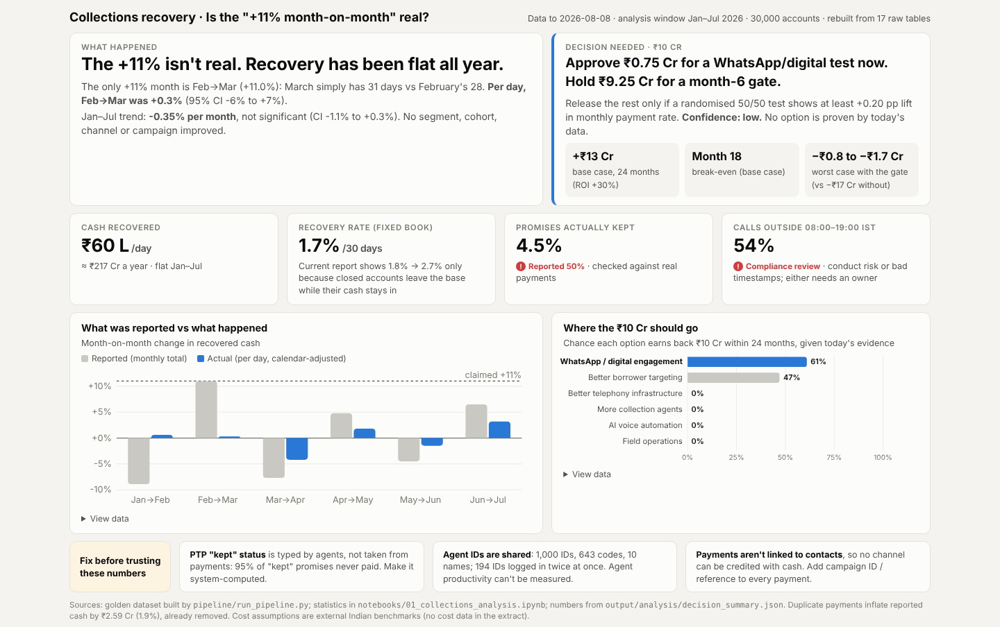

# Collections Recovery: is "+11% month-on-month" real?

Analysis of a collections platform extract (17 tables, 30,000 accounts, 1 Jan – 8 Aug 2026) to test the claim *"Recovery has improved by 11% month-on-month"*, explain what drives recovery, estimate a targeting counterfactual, and recommend where to invest ₹10 Cr.

## Answer in four lines

1. **The +11% isn't real.** It's the Feb→Mar calendar effect (31 vs 28 days = +10.7%). Per day, Feb→Mar was **+0.3%**; the Jan–Jul trend is **−0.35%/month** (95% CI −1.1% to +0.4%). Recovery is flat at **≈₹60 lakh/day (≈₹217 Cr/year)**.
2. **Reporting artefacts made it look like growth:** a live-book denominator that drops "closed" accounts while keeping their cash (+53% fake rate growth), duplicate payments (₹2.59 Cr), and attribution-window left-censoring.
3. **Nothing recorded measurably drives payment** (13 drivers tested), and the mid-year targeting change shows no effect (DiD p = 0.90). Several data links are broken (PTP status, agent IDs, `call_id`, event `borrower_id`).
4. **₹10 Cr → WhatsApp/digital, stage-gated:** ₹0.75 Cr randomised 50/50 test now; release ₹9.25 Cr only if lift ≥ +0.20 pp at month 6. Base case +₹13 Cr over 24 months (ROI +30%); worst case with the gate −₹1.7 Cr. **Confidence: low**, which is exactly why the gate exists.

## Deliverables

| # | Deliverable | Where |
|---|---|---|
| 1 | **SQL repository**: cleaning, transformations, metrics, analytical queries | [`sql/`](sql) (11 files, run in order) |
| 2 | **Analysis notebook**: reasoning from problem formulation (MDP → MRP → hypotheses → BLUEPRNT design) to recommendation | [`notebooks/01_collections_analysis.ipynb`](notebooks/01_collections_analysis.ipynb) · [HTML render](notebooks/01_collections_analysis.html) |
| 3 | **Golden dataset + reproducible pipeline** | [`output/golden/*.parquet`](output/golden) · [`pipeline/run_pipeline.py`](pipeline/run_pipeline.py) |
| 4 | **Data quality report**: issues, detection, treatment, business impact | [`reports/data_quality_report.md`](reports/data_quality_report.md) |
| 5 | **Executive dashboard**: one screen | [`dashboard/index.html`](dashboard/index.html) (open in a browser) ·  |
| 6 | **Executive memo** (2 pages) | [`reports/executive_memo.pdf`](reports/executive_memo.pdf) · [Markdown](reports/executive_memo.md) |
| 7 | **Architecture diagram + production design** | [`docs/architecture.png`](docs/architecture.png) · [`docs/production_design.md`](docs/production_design.md) |

## How to run

```bash
pip install -r requirements.txt            # Python 3.11+
mkdir -p data/raw && cp /path/to/collections_csvs/*.csv data/raw/
make all                                   # pipeline -> notebook -> dashboard -> memo -> diagram
# or step by step:
python pipeline/run_pipeline.py --raw data/raw
```

The pipeline is idempotent (every statement is `CREATE OR REPLACE`), takes about 15 seconds on a laptop, and **exits non-zero if any CRITICAL data-quality gate fails**. The raw extract isn't committed.

## Repository layout

```
sql/
  00_raw.sql            ingest every CSV as text + lineage id (_raw_row)
  01_staging.sql        types, IST clock, row flags             (no rows removed)
  02_clean.sql          dedup, entity resolution, code maps      (rules R-xx)
  03_golden.sql         star schema + 210k-row account-month panel (rules G-x)
  04_dq.sql             row + rupee waterfalls, issue register
  05_forensics.sql      tests A–G (duplicates, attribution, timezone, codes, agents, mix, denominator)
  06_metrics.sql        9 KPIs, naive vs independent definitions
  07_drivers.sql        13 driver dimensions
  08_counterfactual.sql DiD / matching inputs for the targeting change
  09_features.sql       point-in-time features (no leakage)
  10_dq_assertions.sql  CRITICAL/WARN gates + daily anomaly detection
pipeline/               runner, data-contract generator + validator
contracts/sources.yml   data contracts for all 17 feeds
metrics/metrics.yml     versioned KPI definitions
notebooks/              notebook source (build_notebook.py), executed notebook, HTML
dashboard/              dashboard builder + self-contained index.html
reports/                data quality report, executive memo (+ builder)
docs/                   production design, architecture diagram (dot / svg / png)
output/golden/          golden dataset (Parquet)
output/dq/, analysis/   DQ tables, forensic/metric/driver/counterfactual tables, decision_summary.json
```

## Key decisions (details in the notebook §4 and the DQ report)

* **Join on `account_id`, never on event `borrower_id`** (it disagrees with the account on >99.9% of rows).
* **Dedup payments on `payment_id`, not `payment_reference`**: references collide across different payments; deduping on them would delete ₹14.7 Cr of real cash.
* **Fixed population**: accounts never leave a denominator because of status, which blocks survivorship and denominator manipulation.
* **One clock**: all timestamps converted to IST; calls carry their own timezone column.
* **Verified, not entered**: PTP-kept is derived from payments; RPC requires a connected call.
* **Evidence labels** on every conclusion: Fact · Strong Evidence · Correlation · Hypothesis.

## Assumptions and limitations

* No real targeting switch is visible in the data (new/old strategies run side by side all year); the counterfactual uses an assumed 1 Apr 2026 switch and is parameterised for the true date.
* No cost data: investment costs are external Indian benchmarks (sources in notebook §9).
* Client and language aren't in the extract; agent-level findings are capped at Hypothesis because agent identity is broken.
* Observational data can't prove channel effects; the recommended randomised test is designed to.
