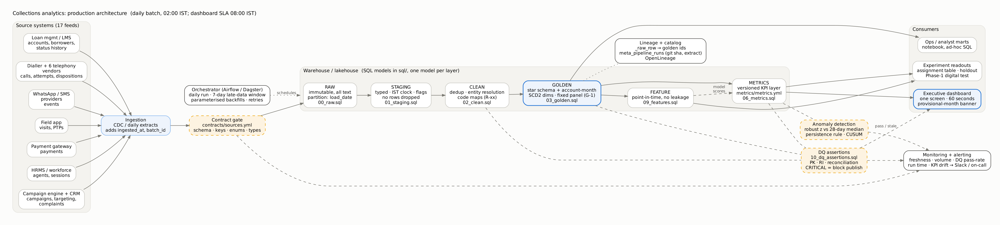

# Production analytics design: Collections recovery

**Goal:** turn this analysis into a system leadership can rely on every morning. Numbers are defined once, reproducible to the row, and blocked from publishing when the data is wrong.

*Source: `docs/architecture.dot` (rendered SVG: `architecture.svg`).*

**What already exists in this repo vs what production adds.** Every layer below is implemented as SQL in `sql/` and runs end to end with `pipeline/run_pipeline.py` on DuckDB. Production moves the same models to the warehouse (each `.sql` file maps to a dbt model or warehouse job) and adds the orchestrator, incremental loading and alerting described here.

## 1. Layers

| Layer | Purpose | Grain / key | Repo implementation | Production refresh |
|---|---|---|---|---|
| **Raw** | Immutable copy of each source feed, all columns as text, nothing dropped | Source row + `batch_id`, `ingested_at`, `_raw_row` | `00_raw.sql` | Append-only, partitioned by `load_date` |
| **Staging** | Types, trimmed codes, **one clock (IST)**, row-level flags. No rows removed | Same as raw | `01_staging.sql` | Incremental over the late-data window |
| **Clean** | Dedup, entity resolution, code harmonisation, verified PTP. Every rule tagged `R-xx` | One row per business entity / event | `02_clean.sql` | Incremental `MERGE` on primary key |
| **Golden** | Star schema (`dim_*`, `fct_*`) + `golden_account_month` panel over a **fixed population** | Facts: event PK; panel: `(account_id, month)` | `03_golden.sql` | Rebuild affected months only |
| **Feature** | Point-in-time features for targeting models and experiment readouts; never uses same-month data | `(account_id, month)` | `09_features.sql` | Rebuild affected months + 3 following |
| **Metrics** | Versioned KPI layer: the only place KPIs are computed | `(metric, month)` / `(metric, day)` | `06_metrics.sql`, `metrics/metrics.yml` | Rebuild affected months |
| **Dashboard** | One-screen executive view; reads Metrics only | Snapshot per run | `dashboard/build_dashboard.py` | Published after the DQ gate passes |

Analytical layers (`04_dq`, `05_forensics`, `07_drivers`, `08_counterfactual`) are marts on top of Golden. They are recomputed on demand, not in the daily critical path.

## 2. Data contracts

Each of the 17 feeds has a contract in `contracts/sources.yml`, agreed with the owning team:

* **Schema:** required columns, types, nullability; allowed values for every code column (e.g. `payment_status ∈ {SUCCESS, FAILED, PENDING, REVERSED}`).
* **Primary key** and **event-time column**, plus the **timezone rule** (e.g. calls: wall-clock in column `timezone`; target state: all sources emit UTC with offset).
* **Freshness SLA** (24 h for event feeds) and **late-arrival tolerance** (7 days).
* **Expected volume** per day, used by volume monitoring.

Enforcement: `pipeline/contracts.py` validates every load right after Raw (`dq_contract_results`). A missing column, null key or unparseable timestamp is **CRITICAL** and stops the run. A new code value or duplicate keys are **WARN**: the run continues, the owner is alerted, and the new code is held out of metrics until a mapping exists. Contract changes are pull requests, reviewed by both producer and consumer.

## 3. Primary keys

| Entity | Natural key in source | Golden key | Note |
|---|---|---|---|
| Payment | `payment_id` | `payment_id` | `payment_reference` is **not** unique (provider collisions) |
| Call | `call_id` | `call_id` | Duplicates and late copies collapse to the earliest timestamp |
| Attempt / Disposition | `attempt_id` / `disposition_id` | same | Their `call_id` is not a valid FK today (source fix #3) |
| Promise | `ptp_id` | `ptp_id` | |
| Account | `account_id` | `account_id` | Fixed panel per allocation cohort |
| Borrower | `borrower_id` + `updated_at` (version) | `borrower_id` (SCD2: `valid_from`, `valid_to`, `is_current`) | Linked only via `accounts.borrower_id` |
| Agent | none reliable | `agent_id` (canonical); SCD2 attributes | Source fix #2: one person = one ID |
| Vendor | `vendor_id` | `vendor_id` → `vendor_group` | 15 IDs, 6 vendors |
| Account-month | n/a | `(account_id, month)` | Zero-filled; every account in every month |

Uniqueness, not-null and referential integrity on these keys are CRITICAL checks (`PK-*`, `NN-*`, `RI-*` in `10_dq_assertions.sql`).

## 4. Metric definitions

All KPIs live in `metrics/metrics.yml`: name, **version**, owner, grain, numerator, denominator, filters, the SQL column that implements it, and **what the previous version did wrong**. Rules that apply to every metric:

* **Fixed population:** accounts never leave a denominator because of status (removes the +53% denominator artefact).
* **Calendar-neutral:** month-on-month comparisons use per-day or per-30-day values; the dashboard never compares raw totals of unequal months.
* **Verified, not entered:** PTP-kept comes from payments; RPC requires a connected call.
* **Changes are versioned:** a definition change bumps `version`, restates history (§7) and shows a "definition changed" note on the dashboard for 30 days.

## 5. Data lineage

* **Row level:** every staging, clean and golden row carries `_raw_row` (and in production `batch_id`), so any number on the dashboard can be traced to the source rows behind it. Example: recovery rate ← `mt_monthly_metrics` ← `golden_account_month.recovered_amt` ← `fct_payment` ← `cln_payments` (rule R-P1) ← `stg_payments` ← `raw_payments` (`_raw_row`).
* **Run level:** `meta_pipeline_runs` records run id, start/end time, **git SHA of the SQL**, source extract, golden row count and DQ results. A dashboard snapshot is therefore pinned to code + data versions.
* **Model level:** dependencies are explicit (one SQL file per layer); in production, emit OpenLineage events from the orchestrator into the data catalog so lineage is browsable.

## 6. Incremental processing and late-arriving data

**Watermarks.** Each run processes event dates in `[watermark − 7 days, today]`. Seven days covers the late copies we observed (1–5 days for calls) plus margin.

| Step | Incremental logic |
|---|---|
| Raw | Append new batch; never update |
| Staging | Re-type rows from new batches only |
| Clean | `MERGE` on the primary key using the same dedup rule as the full build (earliest event time, keep non-null agent, keep the copy with a reference). Re-running a batch is idempotent |
| Golden facts | Upsert changed keys |
| Panel / features / metrics | Find **affected months** (months of any inserted/updated event) and rebuild only those months (features: those months + the next 3, because of look-back windows) |

**Late data inside the window** is absorbed automatically. The current and previous month are labelled **provisional** on the dashboard until the window closes.

**Late data beyond the window** (event older than 7 days) goes to a quarantine table, triggers a WARN, and is merged by the next scheduled backfill. A month is **closed** 35 days after month-end; changes to a closed month are restatements (§7).

## 7. Backfills and restatements

* Every model is **parameterised by date range** and idempotent (`CREATE OR REPLACE` per partition / `MERGE`), so a backfill is the normal job run over a wider range.
* Run backfills into a **shadow schema**, then diff against production: row counts, ₹ by month, every KPI by month. Differences above a tolerance (e.g. 0.5% of monthly cash) require sign-off before swap.
* **Restatement log:** each swap records old vs new values per metric-month; the dashboard links to it. This is how a definition change (e.g. recovery rate v1 → v2) or a source fix (e.g. real `call_id` on dispositions) is applied to history without silent rewrites.

## 8. Data-quality checks

| Layer | Check | Severity | Implemented |
|---|---|---|---|
| Raw | Contract: schema, PK not null, timestamp parse, allowed values | CRITICAL / WARN | `contracts.py` → `dq_contract_results` |
| Raw | Duplicate rate per feed (payments, calls) under 3% | WARN | `UP-01/02` |
| Clean | Event `borrower_id` agrees with account; reported KEPT backed by payments; agent ID integrity | WARN (upstream health) | `UP-03/04/05` |
| Golden | PK uniqueness, not-null, referential integrity | CRITICAL | `PK-*`, `NN-*`, `RI-*` |
| Golden | Panel completeness (accounts × months); panel ₹ = fact ₹ to the rupee | CRITICAL | `RC-01/02` |
| Metrics | One row per month; KPI within plausible bounds | CRITICAL / WARN | `RC-03` |
| Compliance | Calls outside 08:00–19:00 IST under 1% | WARN → compliance owner | `CP-01` |
| Freshness | Latest event within SLA | WARN | `FR-01` |

**Gate behaviour:** any CRITICAL failure stops the run (`run_pipeline.py` exits non-zero). The dashboard keeps the last good snapshot with a red "data delayed" banner; WARN failures publish with an amber note naming the check.

## 9. Monitoring

* **Pipeline health:** run success, duration vs 7-day median, rows processed per layer.
* **Data health:** freshness per feed vs SLA, daily volume vs contract expectation, DQ pass rate, quarantine size.
* **Metric health:** KPI drift and the anomaly flags below; **definition drift**, an alert if the fixed-book and live-book recovery rates diverge by more than 10%, which is the early sign of denominator manipulation returning.
* **Routing:** every check has an owner from the contract; CRITICAL pages the on-call data engineer, WARN goes to the owning team's channel, compliance checks go to the compliance lead.

## 10. Anomaly detection

* **Daily KPIs** (cash, payments, calls, contact rate, duplicate rows): robust z-score vs the trailing **28-day median and MAD**: `z = (x − median) / (1.4826 × MAD)`, flag at |z| > 3.5 (`dq_anomalies`). Median/MAD so one bad day doesn't mask the next.
* **Persistence rule:** alert only if flagged **two days running** or |z| > 5. The current run flags 12 of 960 daily checks, roughly the false-positive rate expected without the rule; the persistence rule cuts this to **2 alerts** over six months.
* **Level shifts:** a one-sided CUSUM on daily recovered cash catches slow drifts that daily z-scores miss (this is how a real improvement, or a slow leak, would surface).
* **Mix shifts:** population stability index on the DPD / risk / loan-type mix of *worked* accounts each month (PSI > 0.1 = review). This guards against a "better" KPI that is really an easier portfolio.
* **Calendar awareness:** anomaly baselines and dashboard comparisons use per-day values and weekday-matched baselines once weekday seasonality appears.

## 11. Operating model

| Item | Choice |
|---|---|
| Schedule | Daily 02:00 IST; dashboard SLA 08:00 IST |
| Ownership | Data engineering owns Raw→Golden; analytics owns Feature→Metrics and `metrics.yml`; collections ops / finance own KPI definitions |
| Testing | SQL models tested in CI on a sample extract (contract + assertions must pass); metric changes need a restatement diff |
| Experiments | Assignment table (`account_id`, `arm`, `assigned_at`) written before treatment starts; readouts computed from Feature + Metrics, never from attribution |
| Access | PII (names, phones, emails) stays in Raw/Staging behind role-based access; Golden and above carry IDs only |
